# monitoring-outputs-thef-public — the observers' dated reports, in costume

*One page a day from the lab's monitor-only observers, readable in a browser: <https://drasticstatic.github.io/monitoring-outputs-thef-public/>*

The lab runs two observers for The Holy Earth Foundation's readers. Both are **monitor-only**: they read public
prices and write down what they saw. Neither holds a wallet that trades, places an order or sends a transaction.

| Folder | What it is |
|---|---|
| [`arb/`](arb/README.md) | the arbitrage observer: a study of price gaps between decentralised exchanges on Arbitrum, one page per study day (`arb/YYYY-MM-DD/README.md`) |
| [`perps/`](perps/README.md) | the Perps listener's pages, when its session publishes them |
| `pdf/` | each page rendered to PDF by this repository's workflow, a minute after the page lands |
| `index.html` | the front end GitHub Pages serves: every dated report with its PDF |

## The costume

Which pairs and venues the study watches, and what those pools hold, stays private. So on this copy pairs and venues
wear **stage names** (a pair is a character like `curious-oblique-egret`; a venue is a house, and a fee tier is a ward,
so `Juniper→Rowan Quay` is a route between two houses), and pool depths are scaled by a secret factor per pair.
Everything else is the real study: counts, spreads in percent, gas, hours, lifetimes and outcomes. The names stay
the same night after night, so a reader can follow a character. Each page passes a leak guard before it is written; a
page that would show a real name is not published.

## Reading it

Open the front end on a phone or a laptop; nothing needs an account. The live study is on its own public dashboard,
<https://drasticstatic.github.io/trading-bot-arbitrage-public/>, with the nightly snapshot it reads at
[`edge/latest.json`](https://drasticstatic.github.io/trading-bot-arbitrage-public/edge/latest.json).

Written nightly at 23:55 ET by the arbitrage observer's report and pushed at 23:58. Tone: brass on slate, the lab's
colours, with The Holy Earth Foundation's amber for links. Created 2026-10-31.
